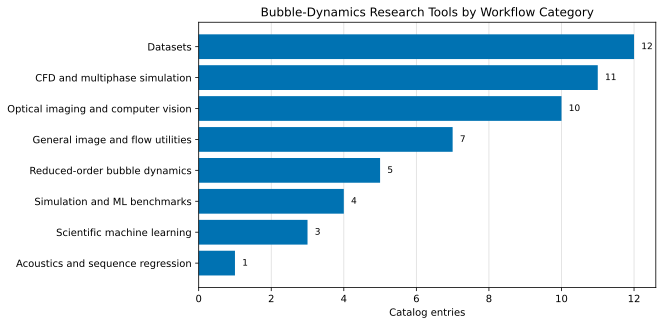
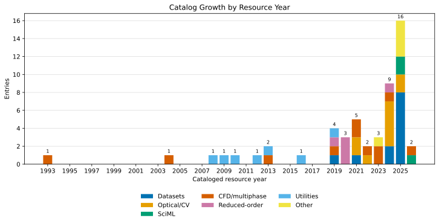
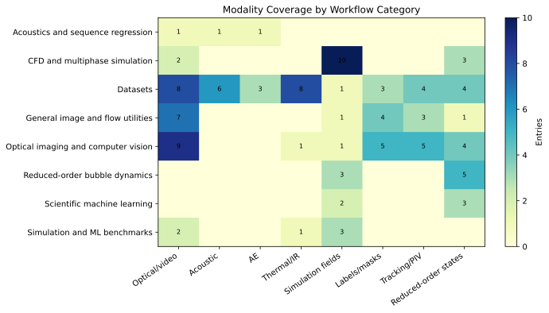
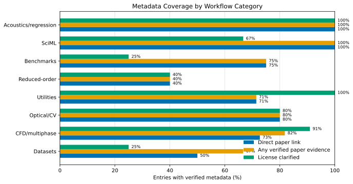

# Bubble Dynamics Research Tools

> A living catalog of datasets, code, models, solvers, and analysis workflows for bubble dynamics research: boiling vapor bubbles, gas-liquid bubbles, optical imaging, acoustic emissions, thermal imaging, reduced-order models, CFD, and scientific machine learning.

Last checked: 2026-07-20.

## Why This Repo Exists

Bubble-dynamics research is increasingly tool-driven. A practical study may combine high-speed video, segmentation, tracking, hydrophone or AE signals, thermal labels, CFD fields, and neural surrogate models. This repository keeps those reusable pieces in one place and makes the catalog maintainable through a structured source table and generated summaries.

The current catalog includes 55 resources. Newer additions include [Bubbleformer](https://github.com/HPCForge/Bubbleformer), [BubbleML 2.0](https://huggingface.co/datasets/hpcforge/BubbleML_2), [NUCLEUS](https://github.com/therml-ai/NUCLEUS), [MFC](https://github.com/MFlowCode/MFC), [VideoSAM](https://github.com/chikap421/videosam), [Bubble Analyser 2.0](https://github.com/dmesap/bubble_analyser), the explicitly licensed cavitation-bubble package [APECSS](https://github.com/polycfd/apecss), and subcooled-flow-boiling AI detection/tracking datasets from Zhou and co-workers. The July 2 maintenance pass addressed the next recurring review weakness after the July 1 artifact-type cleanup: the ranked frontier still let peripheral transfer-only rows compete too strongly with direct bubble-dynamics gaps. The July 3 pass then addressed the next recurring weakness inside the remaining dataset debt by separating direct paper links from title-level citation verification. The July 4 pass focused on the next repeated problem: reduced-order bubble-dynamics rows were still presented mostly as unresolved debt instead of as an adoption ladder. The July 5 pass extended that same decision-ready logic to data-bearing resources with an explicit dataset adoption ladder. The July 6 pass closed the next usability gap after that with a workflow starter matrix. The July 20 pass then pushed the next recurring weakness deeper into the reduced-order layer: it adds a dedicated reduced-order starter-path matrix, upgrades the Harvard multimodal boiling dataset to a direct-paper row, and converts both kozakaron sonochemistry repositories from `no paper evidence` debt into paper-backed but still license-unclear entries.

## Start Here

| Need | Go to |
| --- | --- |
| Choose a tool quickly | [docs/quickstart.md](docs/quickstart.md) |
| Browse the full generated catalog | [docs/catalog.md](docs/catalog.md) |
| See summary tables and trend figures | [docs/summary.md](docs/summary.md) |
| Check evidence and license signals before reuse | [docs/reproducibility_audit.md](docs/reproducibility_audit.md) |
| Add or review a resource | [docs/curation_workflow.md](docs/curation_workflow.md) |
| Use the machine-readable catalog | [data/resources.csv](data/resources.csv) |
| Read the draft arXiv paper | [paper/arxiv/main.tex](paper/arxiv/main.tex) |

## Quick Picks

| Workflow | Start with | Trust signal | Main caveat |
| --- | --- | --- | --- |
| Pool-boiling image segmentation/tracking | [BubbleID](https://github.com/cldunlap73/BubbleID) | Domain-specific code plus paired dataset and paper | Recheck transfer if heater, fluid, illumination, or pressure differ strongly from training. |
| Acoustic or AE heat-flux prediction | [SeqReg](https://github.com/cldunlap73/SeqReg) | Benchmark-ready paired Dryad datasets and direct paper evidence | Split by experiment, not by random windows from the same run. |
| Long-horizon boiling forecasting | [Bubbleformer](https://github.com/HPCForge/Bubbleformer) + [BubbleML 2.0](https://huggingface.co/datasets/hpcforge/BubbleML_2) | Open code plus benchmark-style simulation dataset and direct paper link | Forecast quality still needs experimental validation before physical claims. |
| General bubble-image measurement | [Bubble Analyser 2.0](https://github.com/dmesap/bubble_analyser), [scikit-image](https://scikit-image.org/), or [Trackpy](https://github.com/soft-matter/trackpy) | Mature reusable tooling with clear software provenance | These are flexible utilities, not bubble-physics-specific baselines. |
| High-speed video phase segmentation | [VideoSAM](https://github.com/chikap421/videosam) | Open code, paper, and phase-segmentation data across fluids | Inspect failures around glare, overlap, and rare regimes. |
| Interface-resolved CFD | [Basilisk](https://basilisk.fr/), [Aphros](https://github.com/cselab/aphros), and [OpenFOAM](https://www.openfoam.org/) | Strong solver lineage and verification-oriented examples | Solver choice does not replace boiling-model, mesh, and boundary-condition validation. |
| Compressible bubble collapse or cavitation CFD | [MFC](https://github.com/MFlowCode/MFC) | Direct software citation, examples, and regression-tested compressible workflows | Use when compressibility matters; it is not the default for ordinary incompressible boiling studies. |
| Reduced-order cavitation acoustics | [APECSS](https://github.com/polycfd/apecss) | Explicit open license plus JOSS paper and release-backed examples | Best fit for spherical pressure-driven cavitation bubbles, not for wall-bounded boiling closures. |

If you want the fuller task-by-task view, start with the generated workflow starter matrix in [`docs/summary.md`](docs/summary.md) or [`docs/reproducibility_audit.md`](docs/reproducibility_audit.md). If your question is specifically about reduced-order or cavitation-style bubble models, also read the new reduced-order starter-path matrix there; it separates pedagogical Rayleigh-Plesset anchors, sonochemistry-focused repositories, and cavitation-acoustics tooling instead of treating them as one flat weak category.

## Catalog Snapshot











## Maintain The Catalog

The source of truth is [`data/resources.csv`](data/resources.csv). After editing it, regenerate the catalog, audit page, and figures:

```powershell
python scripts/render_catalog.py
```

To look for new GitHub candidates:

```powershell
python scripts/discover_candidates.py --output docs/discovery_candidates.md
```

Candidate resources should be screened for physical regime, input/output data, license, examples, dependencies, validation, and failure modes before they are added.

The generated [`docs/reproducibility_audit.md`](docs/reproducibility_audit.md) page highlights entries that still need manual license checks, rely on review-sharing links, expose only partial evidence bundles, or cluster in categories with weak paper evidence. It now breaks the remaining queue down by review focus, by workflow category, by blocker type (`catalog backfill`, `citation discoverability`, `upstream sparsity`, or `access/link stability`), by blocker-by-category and paper-evidence figures, by a scope-alignment figure, and by both a ranked maintenance frontier and a filtered backfill-ready queue. After the June 30 through July 20 direct-source, ranking, citation-evidence, and reduced-order revisions, rows such as the Zhou repositories, `BubbleML`, `bubble-dynamics-resnet`, `Boiling Learning`, the Mendeley `sound of boiling` dataset, and the Harvard Dataverse multimodal dataset are no longer mixed together with documentation-policy debt, peripheral transfer-only scope debt, or previously paperless sonochemistry rows whose public pages now do have stable article links. The same audit also treats documentation pages differently from standalone code artifacts, makes scope alignment explicit before maintainers spend another pass on a weak row, and now separates reduced-order starter choices by task rather than leaving the whole category as one negative bucket.

If you specifically need reduced-order baselines, start with the generated reduced-order triage tables in [`docs/summary.md`](docs/summary.md) and [`docs/reproducibility_audit.md`](docs/reproducibility_audit.md). They separate `Reference-backed` rows from `Paper-backed, license unclear` and `Prototype-only` rows, which is more useful than reading reduced-order entries as one flat weak category.

If your first decision is which data source to trust, use the new dataset adoption ladder in [`docs/summary.md`](docs/summary.md) and [`docs/reproducibility_audit.md`](docs/reproducibility_audit.md). It separates `Benchmark-ready` rows from `Citation-verified dataset`, `Archive-only discovery lead`, and `Access-risky transfer dataset` entries so the strongest starting points are obvious.

## Contributing

Pull requests and issues are welcome. Please include a stable link, physical regime, modalities, reproducibility details, license or archive terms, and one sentence explaining what a bubble-dynamics researcher can do with the resource.

Suggested catalog entry shape:

```markdown
| Name | Kind | Regime | Modality | Workflow | Stack | Year | Status | Notes |
```

## Verification Notes

- GitHub, Dryad, Dataverse, Mendeley Data, Hugging Face, NASA DASHlink, and project documentation pages were checked during the June 2026 update.
- The figures summarize this curated catalog, not the complete literature.
- CFD and ML entries should not be treated as validated in a new boiling regime without independent checks for calibration, data leakage, mesh independence, boundary conditions, phase-change assumptions, uncertainty, and failure cases.
