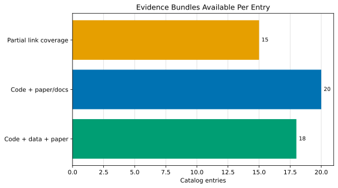
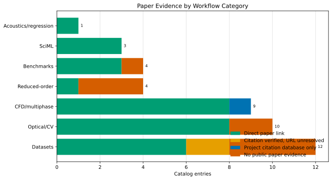
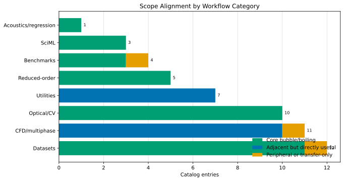
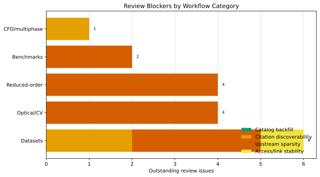
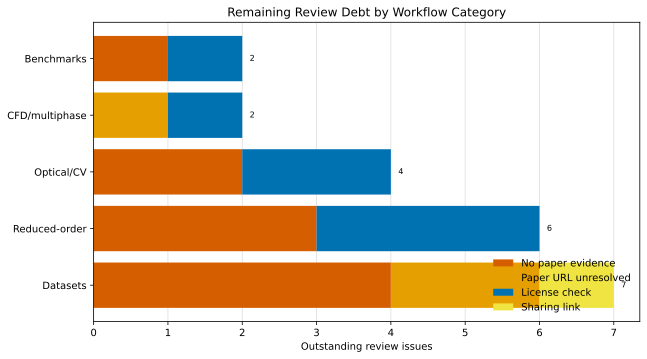

# Reproducibility Audit

<!-- Generated by scripts/render_catalog.py from data/resources.csv. Do not edit this file by hand. -->

This page surfaces curation-quality signals that are hard to see from raw category counts alone. It is not a pass/fail judgment; it is a prioritization aid for maintainers and users deciding which resources are easiest to reproduce or safest to adopt first.

## Evidence Snapshot

| Evidence tier | Count |
| --- | ---: |
| Code + paper/docs | 23 |
| Dataset + paper | 1 |
| Code + data + paper | 18 |
| Partial link coverage | 12 |

## License Snapshot

| License bucket | Count |
| --- | ---: |
| Explicit open license | 30 |
| Archive/model terms | 12 |
| Manual license review | 9 |
| Explicit restrictive terms | 2 |
| Source-available non-commercial | 1 |

## Paper Evidence Snapshot

| Paper evidence state | Count |
| --- | ---: |
| Direct paper link | 40 |
| Citation text verified, URL unresolved | 2 |
| Project citation database only | 1 |
| No public paper evidence surfaced | 11 |

## Scope Snapshot

| Scope alignment | Count |
| --- | ---: |
| Core bubble/boiling | 34 |
| Adjacent but directly useful | 17 |
| Peripheral or transfer-only | 3 |

## Coverage By Category

This table makes the recurring weak spots explicit: categories with low direct-paper-link coverage or low license clarity need deeper maintenance before they can support confident reuse. It also separates direct paper links from title-level citation verification so unresolved URL discoverability does not masquerade as total citation absence.

| Category | Entries | Direct paper link | Any verified paper evidence | License clarified | Open/permissive | Explicit restrictive | Strong evidence bundle |
| --- | ---: | ---: | ---: | ---: | ---: | ---: | ---: |
| Reduced-order bubble dynamics | 6 | 5 (83%) | 5 (83%) | 3 (50%) | 3 | 0 | 5 |
| Datasets | 12 | 7 (58%) | 9 (75%) | 3 (25%) | 3 | 0 | 7 |
| General image and flow utilities | 7 | 5 (71%) | 5 (71%) | 7 (100%) | 7 | 0 | 5 |
| CFD and multiphase simulation | 11 | 8 (73%) | 9 (82%) | 10 (91%) | 7 | 0 | 10 |
| Simulation and ML benchmarks | 4 | 3 (75%) | 3 (75%) | 1 (25%) | 0 | 1 | 3 |
| Optical imaging and computer vision | 10 | 8 (80%) | 8 (80%) | 8 (80%) | 8 | 0 | 8 |
| Scientific machine learning | 3 | 3 (100%) | 3 (100%) | 2 (67%) | 1 | 1 | 3 |
| Acoustics and sequence regression | 1 | 1 (100%) | 1 (100%) | 1 (100%) | 1 | 0 | 1 |

## Dataset Adoption Ladder

The dataset layer now gets its own adoption ladder because repeated review comments have shifted from flat metadata debt toward user trust and reuse order. Prefer `Benchmark-ready` datasets when you need a defensible starting point for baselines or manuscript figures; treat `Archive-only discovery lead` and `Access-risky transfer dataset` rows as exploratory resources until you independently verify provenance, licensing, and fit to your regime.

| Dataset readiness | Count |
| --- | ---: |
| Benchmark-ready | 10 |
| Citation-verified dataset | 2 |
| Archive-only discovery lead | 3 |
| Access-risky transfer dataset | 2 |

| Resource | Category | Paper evidence | License bucket | Readiness | Last checked |
| --- | --- | --- | --- | --- | --- |
| [BubbleID dataset](https://datadryad.org/dataset/doi:10.5061/dryad.ksn02v7gx) | Datasets | Direct paper link | Archive/model terms | Benchmark-ready | 2026-06-20 |
| [Hit2Flux acoustic-emission dataset](https://datadryad.org/dataset/doi:10.5061/dryad.g79cnp628) | Datasets | Direct paper link | Archive/model terms | Benchmark-ready | 2026-06-20 |
| [Nonintrusive heat flux quantification using acoustic emissions during pool boiling](https://datadryad.org/dataset/doi:10.5061/dryad.q573n5tvq) | Datasets | Direct paper link | Archive/model terms | Benchmark-ready | 2026-06-20 |
| [Results of bubble detection and tracking of subcooled boiling flow](https://data.mendeley.com/datasets/sg46yyrsmv/2) | Datasets | Direct paper link | Explicit open license | Benchmark-ready | 2026-06-27 |
| [Subcooled flow boiling AI model and dataset](https://data.mendeley.com/datasets/p5zskggvwx/1) | Datasets | Direct paper link | Explicit open license | Benchmark-ready | 2026-06-20 |
| [Temporal-spatial transient boiling heat-flux dataset](https://datadryad.org/dataset/doi:10.5061/dryad.6m905qgc7) | Datasets | Direct paper link | Archive/model terms | Benchmark-ready | 2026-06-20 |
| [VideoSAM](https://github.com/chikap421/videosam) | Optical imaging and computer vision | Direct paper link | Explicit open license | Benchmark-ready | 2026-06-20 |
| [BubbleML 2.0](https://huggingface.co/datasets/hpcforge/BubbleML_2) | Simulation and ML benchmarks | Direct paper link | Archive/model terms | Benchmark-ready | 2026-06-20 |
| [BubbleML](https://github.com/HPCForge/BubbleML) | Simulation and ML benchmarks | Direct paper link | Manual license review | Benchmark-ready | 2026-07-06 |
| [Generalizable physical descriptors of pool boiling heat transfer from unsupervised learning of images](https://datadryad.org/dataset/doi:10.5061/dryad.kh18932mw) | Datasets | Citation text verified, URL unresolved | Archive/model terms | Citation-verified dataset | 2026-07-03 |
| [Unveiling hysteresis of transient boiling: A multimodal perspective](https://datadryad.org/dataset/doi:10.5061/dryad.ksn02v7h2) | Datasets | Citation text verified, URL unresolved | Archive/model terms | Citation-verified dataset | 2026-07-03 |
| [Deep learning the sound of boiling for advance prediction of boiling crisis](https://data.mendeley.com/datasets/vnnzc7n97m/1) | Datasets | No public paper evidence surfaced | Explicit open license | Archive-only discovery lead | 2026-07-04 |
| [NASA DASHlink incipient boiling dataset](https://c3.ndc.nasa.gov/dashlink/resources/1019/) | Datasets | No public paper evidence surfaced | Archive/model terms | Archive-only discovery lead | 2026-06-26 |
| [Pool Boiling Dataset: Synchronized Acoustic, Optical, and Thermal Measurements](https://dataverse.harvard.edu/dataset.xhtml?persistentId=doi:10.7910/DVN/6GLGC6) | Datasets | Direct paper link | Archive/model terms | Benchmark-ready | 2026-07-20 |
| [FluidVerse 2D shock-induced air bubble collapse in water](https://huggingface.co/datasets/FluidVerse/2D_SABW_SSOO) | Simulation and ML benchmarks | No public paper evidence surfaced | Explicit restrictive terms | Archive-only discovery lead | 2026-06-28 |
| [Two-phase immersion cooler for medium-voltage silicon carbide MOSFETs](https://datadryad.org/share/_SEP3K4u6OjIrECuTetxr2AqVoqs5EKJOl8yusAWL8c) | Datasets | No public paper evidence surfaced | Archive/model terms | Access-risky transfer dataset | 2026-06-20 |
| [FluidNexus datasets](https://huggingface.co/datasets/yuegao/FluidNexusDatasets) | Simulation and ML benchmarks | Direct paper link | Archive/model terms | Access-risky transfer dataset | 2026-06-24 |

## Workflow Starter Matrix

Repeated review comments have shifted from `what exists` toward `what should a researcher trust first`. This matrix answers that user-facing question directly by pairing each workflow with a recommended anchor, supporting rows, and the main caveat that still limits blind reuse.

| Workflow | Start here first | Supporting rows | Trust signal | Why this is the best first stop | Main caveat |
| --- | --- | --- | --- | --- | --- |
| Pool-boiling segmentation and tracking | [BubbleID](https://github.com/cldunlap73/BubbleID) | [BubbleID dataset](https://datadryad.org/dataset/doi:10.5061/dryad.ksn02v7gx) | Code + data + paper, Benchmark-ready | Domain-specific code, annotations, model weights, and a paired dataset make this the strongest first stop for pool-boiling imagery. | Recheck transfer if heater, fluid, illumination, or pressure differ strongly from the released training distribution. |
| Subcooled flow-boiling detection and thermal-hydraulic extraction | [Bubble detection and tracking AI-based YOLO tracking algorithm](https://github.com/zhouzhouwen/Bubble_detection_and_tracking) | [Subcooled flow boiling AI model and dataset](https://data.mendeley.com/datasets/p5zskggvwx/1), [Results of bubble detection and tracking of subcooled boiling flow](https://data.mendeley.com/datasets/sg46yyrsmv/2) | Code + data + paper, Benchmark-ready | The code and paired Mendeley artifacts expose a direct paper trail plus tracked thermal-hydraulic outputs for condensing bubbles. | The public repositories still do not surface an explicit license file, so reuse terms should be checked before redistribution. |
| Acoustic or AE heat-flux prediction | [SeqReg](https://github.com/cldunlap73/SeqReg) | [Nonintrusive heat flux quantification using acoustic emissions during pool boiling](https://datadryad.org/dataset/doi:10.5061/dryad.q573n5tvq), [Hit2Flux acoustic-emission dataset](https://datadryad.org/dataset/doi:10.5061/dryad.g79cnp628) | Code + data + paper, Benchmark-ready | SeqReg is the clearest signal-first baseline because it is paired with benchmark-ready Dryad datasets and a direct paper link. | Do experiment-wise splits and recheck label timing before trusting strong scores from temporally adjacent windows. |
| High-speed video phase segmentation across fluids | [VideoSAM](https://github.com/chikap421/videosam) | - | Benchmark-ready | VideoSAM offers a transferable video-segmentation baseline with open code, data, and paper evidence when domain-specific boiling labels are limited. | Treat it as a strong segmentation baseline, not as a boiling-physics model; inspect failure cases around glare, overlap, and rare regimes. |
| Long-horizon boiling forecasting | [Bubbleformer](https://github.com/HPCForge/Bubbleformer) | [BubbleML 2.0](https://huggingface.co/datasets/hpcforge/BubbleML_2) | Code + data + paper, Benchmark-ready | Bubbleformer plus BubbleML 2.0 is the cleanest current forecasting stack: direct paper link, open code, and benchmark-oriented simulation data. | The benchmark is simulation-derived, so downstream claims still need regime-specific validation against experiments. |
| Bubble or boiling surrogate modeling | [NUCLEUS](https://github.com/therml-ai/NUCLEUS) | [BubbleML](https://github.com/HPCForge/BubbleML), [BubbleML 2.0](https://huggingface.co/datasets/hpcforge/BubbleML_2) | Code + data + paper, Benchmark-ready | NUCLEUS and the BubbleML family cover modern surrogate-learning workflows across saturated and subcooled pool-boiling simulations. | NUCLEUS is technically rich but carries explicit non-commercial and no-derivatives terms, while BubbleML still needs manual license confirmation from the GitHub page. |
| Interface-resolved CFD baseline | [Basilisk](https://basilisk.fr/), [Aphros](https://github.com/cselab/aphros) | [Basilisk Rayleigh-Plesset test](https://basilisk.fr/src/test/bubble.h) | Code + paper/docs, Reference-backed | Basilisk and Aphros provide the strongest open solver anchors for interface-resolved work, and the Basilisk Rayleigh-Plesset test gives a reference-backed verification bridge. | Do not infer phase-change validity from a solver name alone; contact angle, mesh, EOS, and boiling closure choices still dominate trust. |
| Compressible bubble collapse or shock-bubble CFD | [MFC](https://github.com/MFlowCode/MFC) | - | Code + paper/docs | MFC is the clearest fit when compressibility, shocks, cavitation, or sub-grid bubble populations make incompressible VOF tools a mismatch. | Its relevance is regime-specific: use it when compressibility matters, not as a default replacement for simpler boiling workflows. |
| Reduced-order single-bubble baseline | [Basilisk Rayleigh-Plesset test](https://basilisk.fr/src/test/bubble.h) | [Bubble-dynamic](https://github.com/BerryWei/Bubble-dynamic) | Reference-backed, Paper-backed, license unclear | The Basilisk verification case is the safest anchor, while Bubble-dynamic is a useful paper-backed pedagogical companion. | Prototype-like reduced-order repositories remain educational unless you independently verify equations, parameters, and reuse terms. |

## Reduced-Order Starter Paths

This section is the deeper response to the recurring reduced-order critique. Instead of only telling users which rows are weak, it tells them which reduced-order row best matches a specific task and what caveat still blocks blind trust.

| Need | Start here first | Supporting row | Trust signal | Why this is the best first stop | Main caveat |
| --- | --- | --- | --- | --- | --- |
| Learn or sanity-check Rayleigh-Plesset behavior | [Basilisk Rayleigh-Plesset test](https://basilisk.fr/src/test/bubble.h) | [Bubble-dynamic](https://github.com/BerryWei/Bubble-dynamic) | Reference-backed | The Basilisk verification case is the safest anchor for single-bubble baseline behavior, and Bubble-dynamic is a compact paper-backed companion for inspecting the governing equations in Python or MATLAB. | Use these as spherical-bubble baselines, not as substitutes for non-spherical, thermal, or wall-confined physics. |
| Model chemistry-coupled sonochemistry bubbles | [Bubble_dynamics_simulation_CPP](https://github.com/kozakaron/Bubble_dynamics_simulation_CPP) | [Bubble_dynamics_simulation](https://github.com/kozakaron/Bubble_dynamics_simulation) | Paper-backed, license unclear | The C++ codebase is the strongest current sonochemistry-oriented reduced-order row because it has current build documentation, packaged releases, and now a direct journal citation that explicitly references the repository. | Both repositories still have license-review debt, so they are strong technical leads but not frictionless redistribution choices. |
| Study cavitation acoustics or emitted pressure pulses | [APECSS](https://github.com/polycfd/apecss) | - | Reference-backed | APECSS is the clearest cavitation-acoustics entry in the category: explicit MPL-2.0 licensing, a JOSS paper, Zenodo releases, and pressure-driven spherical-bubble examples centered on emitted-pressure prediction. | It is targeted at pressure-driven spherical cavitation bubbles, so boiling-specific wall heat-transfer, nucleation-site, and non-spherical collapse effects still need separate validation. |

## Reduced-Order Triage

This category remains the clearest recurring weak spot, so it needs a more concrete read than `lowest paper coverage`. The table below distinguishes rows that are safe as reference anchors from rows that are still mainly pedagogical or prototype code.

| Resource | Status | Paper evidence | License bucket | Readiness | Last checked |
| --- | --- | --- | --- | --- | --- |
| [APECSS](https://github.com/polycfd/apecss) | active | Direct paper link | Explicit open license | Reference-backed | 2026-07-20 |
| [Basilisk Rayleigh-Plesset test](https://basilisk.fr/src/test/bubble.h) | active | Direct paper link | Explicit open license | Reference-backed | 2026-06-22 |
| [Bubble-dynamic](https://github.com/BerryWei/Bubble-dynamic) | active | Direct paper link | Manual license review | Paper-backed, license unclear | 2026-07-04 |
| [Bubble_dynamics_simulation](https://github.com/kozakaron/Bubble_dynamics_simulation) | deprecated | Direct paper link | Manual license review | Paper-backed, license unclear | 2026-07-20 |
| [Bubble_dynamics_simulation_CPP](https://github.com/kozakaron/Bubble_dynamics_simulation_CPP) | active | Direct paper link | Manual license review | Paper-backed, license unclear | 2026-07-20 |
| [bubble-dynamics-resnet](https://github.com/comp-physics/bubble-dynamics-resnet) | archived | No public paper evidence surfaced | Explicit open license | Code-backed, paper sparse | 2026-06-30 |

## Remaining Review Focus Counts

Repeated review comments often recur because the queue mixes different problems together. This table separates rows with no public paper evidence from rows that expose citation text but still lack a stable article URL, along with license debt and unstable sharing links.

| Review focus | Count |
| --- | ---: |
| no paper evidence | 7 |
| license check | 7 |
| paper URL unresolved | 3 |
| sharing link | 1 |

## Review Blocker Types

Not every unresolved row is weak for the same reason. This table separates backlog caused by missing maintainer backfill from rows where the upstream archive or repository still does not expose stronger evidence, or only exposes citation text without a stable URL.

| Blocker type | Count |
| --- | ---: |
| upstream sparsity | 10 |
| citation discoverability | 3 |
| access/link stability | 1 |

## Review Blockers By Category

This figure and table separate solvable maintainer backfill from citation discoverability limits and genuine upstream sparsity so repeated comments can be answered with the right kind of revision effort.

| Category | Total issues | Catalog backfill | Citation discoverability | Upstream sparsity | Access/link stability |
| --- | ---: | ---: | ---: | ---: | ---: |
| Datasets | 5 | 0 | 2 | 2 | 1 |
| Optical imaging and computer vision | 4 | 0 | 0 | 4 | 0 |
| Reduced-order bubble dynamics | 4 | 0 | 0 | 4 | 0 |
| Simulation and ML benchmarks | 2 | 0 | 0 | 2 | 0 |
| CFD and multiphase simulation | 1 | 0 | 1 | 0 | 0 |

## Review Debt By Category

This view is the direct response to recurring comments: it shows whether a weak category is mostly held back by missing paper evidence, unresolved paper URLs, generic licenses, or unstable archive links.

| Category | Total review issues | No paper evidence | Paper URL unresolved | License check | Sharing link |
| --- | ---: | ---: | ---: | ---: | ---: |
| Datasets | 6 | 3 | 2 | 0 | 1 |
| Reduced-order bubble dynamics | 4 | 1 | 0 | 3 | 0 |
| Optical imaging and computer vision | 4 | 2 | 0 | 2 | 0 |
| CFD and multiphase simulation | 2 | 0 | 1 | 1 | 0 |
| Simulation and ML benchmarks | 2 | 1 | 0 | 1 | 0 |

## Manual Review Queue

Resources listed here need extra attention because their license is generic or unclear, they rely on a review-sharing link, they expose only citation text without a stable paper URL, or they do not expose public paper evidence at all.

| Resource | Category | Scope alignment | Review focus | Blocker type |
| --- | --- | --- | --- | --- |
| [MFiX](https://mfix.netl.doe.gov/mfix/) | CFD and multiphase simulation | Peripheral or transfer-only | license check, paper URL unresolved | citation discoverability |
| [Two-phase immersion cooler for medium-voltage silicon carbide MOSFETs](https://datadryad.org/share/_SEP3K4u6OjIrECuTetxr2AqVoqs5EKJOl8yusAWL8c) | Datasets | Peripheral or transfer-only | sharing link, no paper evidence | access/link stability |
| [Boiling Learning](https://github.com/ruancomelli/boiling-learning) | Optical imaging and computer vision | Core bubble/boiling | no paper evidence | upstream sparsity |
| [Bubble detection and tracking AI-based YOLO tracking algorithm](https://github.com/zhouzhouwen/Bubble_detection_and_tracking) | Optical imaging and computer vision | Core bubble/boiling | license check | upstream sparsity |
| [Bubble-dynamic](https://github.com/BerryWei/Bubble-dynamic) | Reduced-order bubble dynamics | Core bubble/boiling | license check | upstream sparsity |
| [bubble-dynamics-resnet](https://github.com/comp-physics/bubble-dynamics-resnet) | Reduced-order bubble dynamics | Core bubble/boiling | no paper evidence | upstream sparsity |
| [BubbleML](https://github.com/HPCForge/BubbleML) | Simulation and ML benchmarks | Core bubble/boiling | license check | upstream sparsity |
| [BURST](https://github.com/BUbbleRST/BURST/) | Optical imaging and computer vision | Core bubble/boiling | no paper evidence | upstream sparsity |
| [Deep learning the sound of boiling for advance prediction of boiling crisis](https://data.mendeley.com/datasets/vnnzc7n97m/1) | Datasets | Core bubble/boiling | no paper evidence | upstream sparsity |
| [FluidVerse 2D shock-induced air bubble collapse in water](https://huggingface.co/datasets/FluidVerse/2D_SABW_SSOO) | Simulation and ML benchmarks | Core bubble/boiling | no paper evidence | upstream sparsity |
| [Generalizable physical descriptors of pool boiling heat transfer from unsupervised learning of images](https://datadryad.org/dataset/doi:10.5061/dryad.kh18932mw) | Datasets | Core bubble/boiling | paper URL unresolved | citation discoverability |
| [NASA DASHlink incipient boiling dataset](https://c3.ndc.nasa.gov/dashlink/resources/1019/) | Datasets | Core bubble/boiling | no paper evidence | upstream sparsity |
| [Robust TH analysis method for bubbles using AI](https://github.com/zhouzhouwen/The-Robust-Development-of-a-TH-Analysis-Method-for-Bubbles-Using-AI) | Optical imaging and computer vision | Core bubble/boiling | license check | upstream sparsity |
| [Unveiling hysteresis of transient boiling: A multimodal perspective](https://datadryad.org/dataset/doi:10.5061/dryad.ksn02v7h2) | Datasets | Core bubble/boiling | paper URL unresolved | citation discoverability |

## Priority Maintenance Frontier

The flat queue above is useful for completeness, but repeated daily comments usually recur because the hardest rows sit in the weakest categories and go unaddressed. This ranked frontier now also accounts for scope alignment and citation-evidence state so the first rows are more likely to matter directly to bubble-dynamics users rather than to peripheral transfer-only cases.

| Resource | Category | Scope alignment | Review focus | Blocker type | Last checked | Age (days) | Priority score |
| --- | --- | --- | --- | --- | --- | ---: | ---: |
| [NASA DASHlink incipient boiling dataset](https://c3.ndc.nasa.gov/dashlink/resources/1019/) | Datasets | Core bubble/boiling | no paper evidence | upstream sparsity | 2026-06-26 | 24 | 52 |
| [Two-phase immersion cooler for medium-voltage silicon carbide MOSFETs](https://datadryad.org/share/_SEP3K4u6OjIrECuTetxr2AqVoqs5EKJOl8yusAWL8c) | Datasets | Peripheral or transfer-only | sharing link, no paper evidence | access/link stability | 2026-06-20 | 30 | 50 |
| [Generalizable physical descriptors of pool boiling heat transfer from unsupervised learning of images](https://datadryad.org/dataset/doi:10.5061/dryad.kh18932mw) | Datasets | Core bubble/boiling | paper URL unresolved | citation discoverability | 2026-07-03 | 17 | 45 |
| [Unveiling hysteresis of transient boiling: A multimodal perspective](https://datadryad.org/dataset/doi:10.5061/dryad.ksn02v7h2) | Datasets | Core bubble/boiling | paper URL unresolved | citation discoverability | 2026-07-03 | 17 | 45 |
| [bubble-dynamics-resnet](https://github.com/comp-physics/bubble-dynamics-resnet) | Reduced-order bubble dynamics | Core bubble/boiling | no paper evidence | upstream sparsity | 2026-06-30 | 20 | 44 |
| [Deep learning the sound of boiling for advance prediction of boiling crisis](https://data.mendeley.com/datasets/vnnzc7n97m/1) | Datasets | Core bubble/boiling | no paper evidence | upstream sparsity | 2026-07-04 | 16 | 44 |
| [Boiling Learning](https://github.com/ruancomelli/boiling-learning) | Optical imaging and computer vision | Core bubble/boiling | no paper evidence | upstream sparsity | 2026-07-01 | 19 | 43 |
| [FluidVerse 2D shock-induced air bubble collapse in water](https://huggingface.co/datasets/FluidVerse/2D_SABW_SSOO) | Simulation and ML benchmarks | Core bubble/boiling | no paper evidence | upstream sparsity | 2026-06-28 | 22 | 42 |
| [Bubble-dynamic](https://github.com/BerryWei/Bubble-dynamic) | Reduced-order bubble dynamics | Core bubble/boiling | license check | upstream sparsity | 2026-07-04 | 16 | 40 |
| [BURST](https://github.com/BUbbleRST/BURST/) | Optical imaging and computer vision | Core bubble/boiling | no paper evidence | upstream sparsity | 2026-07-05 | 15 | 39 |
| [Bubble detection and tracking AI-based YOLO tracking algorithm](https://github.com/zhouzhouwen/Bubble_detection_and_tracking) | Optical imaging and computer vision | Core bubble/boiling | license check | upstream sparsity | 2026-07-06 | 14 | 38 |
| [Robust TH analysis method for bubbles using AI](https://github.com/zhouzhouwen/The-Robust-Development-of-a-TH-Analysis-Method-for-Bubbles-Using-AI) | Optical imaging and computer vision | Core bubble/boiling | license check | upstream sparsity | 2026-07-06 | 14 | 38 |

## Backfill-Ready Queue

This filtered queue is the direct answer to recurring `catalog backfill` critiques: if a row appears here, a deeper maintainer pass should change the repository metadata rather than merely restating the blocker. Rows that have already been reclassified as `citation discoverability` should not keep reappearing here unless a new stable URL or DOI is actually found.

| Resource | Category | Review focus | Last checked | Age (days) | Priority score |
| --- | --- | --- | --- | ---: | ---: |

## How To Use This Audit

- Prefer `Code + data + paper` entries when you need a strong starting point for benchmarking or reproduction.
- Treat `Manual license review`, `Archive/model terms`, and `Unclear license` entries as useful technical leads, but confirm redistribution and reuse terms before building on them.
- Treat `Explicit restrictive terms` and `Source-available non-commercial` entries as clearly documented but reuse-restricted: they may be strong technical references while still being unsuitable for commercial or broadly redistributable downstream work.
- Revisit `review sharing` and partial-link entries during future maintenance runs because they are more likely to rot or leave key assumptions undocumented.
- Use the blocker labels to separate solvable catalog-backfill rows from citation discoverability and genuine upstream sparsity; repeated comments should trigger deeper verification only when the blocker type remains `catalog backfill`.
- Treat `paper URL unresolved` as a discoverability problem, not automatically as missing scholarship. If the public archive page proves the title or citation but not the canonical article URL, record that explicitly and move on.
- In the reduced-order category, prefer `Reference-backed` entries for baseline comparisons, and treat `Prototype-only` rows as educational code unless you independently verify equations, parameters, and reuse terms.
- In the dataset ladder, prefer `Benchmark-ready` rows when you need a defensible baseline, and treat `Archive-only discovery lead` rows as useful leads rather than manuscript-grade evidence by default.
- Start each new maintenance pass with the `Priority Maintenance Frontier`, but read its `Scope alignment` column before spending effort on transfer-only rows.
